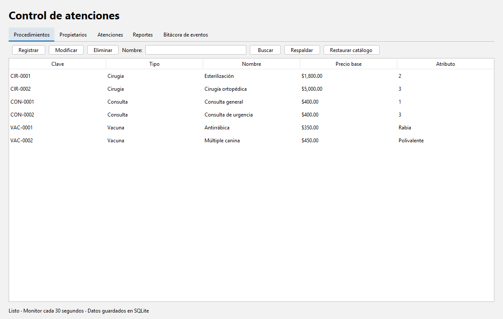
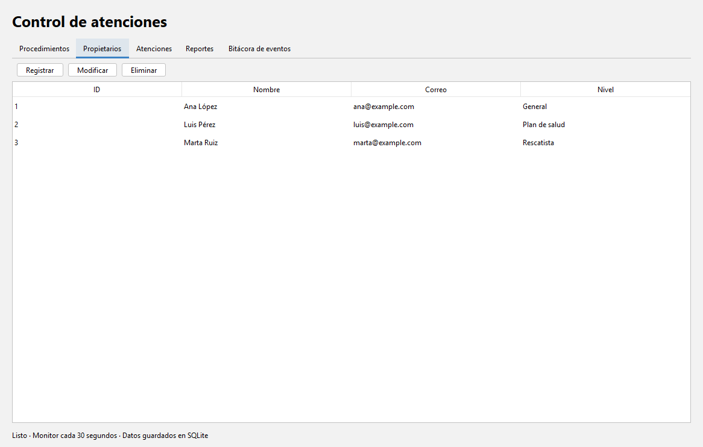
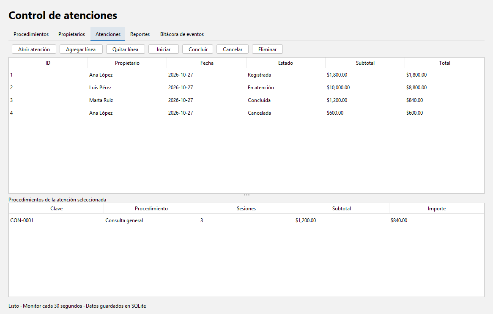
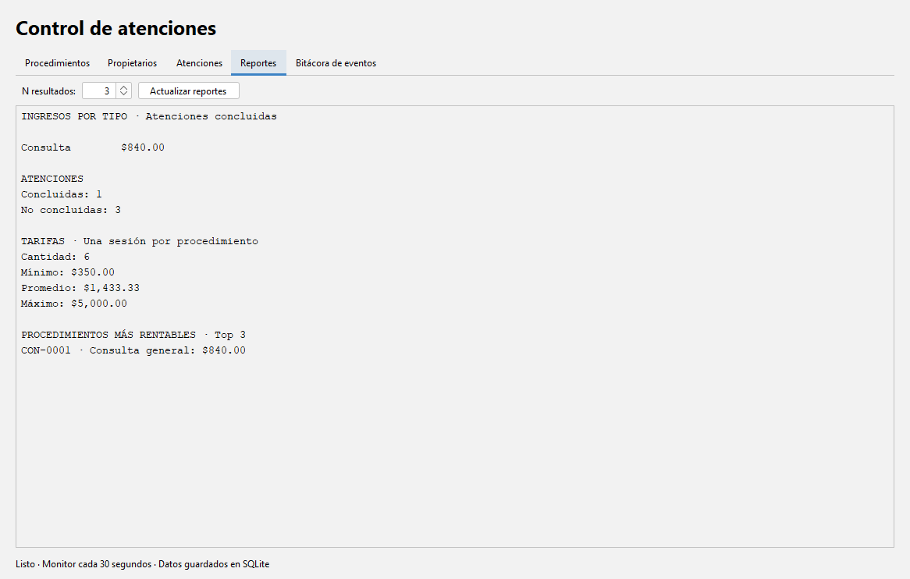
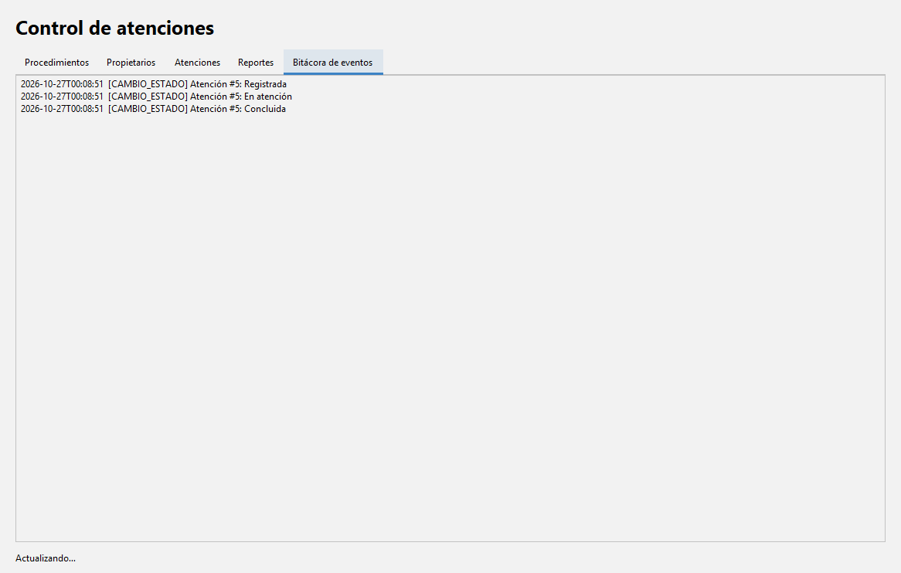

# Control de Atenciones de una Clínica Veterinaria

**Tecnológico Nacional de México · Instituto Tecnológico de Orizaba**  
**Maestría en Sistemas Computacionales · Tecnologías de Programación · Miniproyecto Java 3**

Sistema de escritorio desarrollado en **Java 21** para administrar procedimientos veterinarios, propietarios y atenciones. Permite registrar vacunas, consultas y cirugías, calcular importes y descuentos, controlar el estado de cada atención, emitir alertas de seguimiento y consultar reportes. La información se conserva en una base de datos **SQLite**.

**Tecnologías:** Java 21 · Swing · FlatLaf 3.5.4 · SQLite JDBC 3.46.1.3 · Apache Maven.

> **Contenido del README:** instrucciones para instalar y ejecutar el proyecto, justificación de la interfaz gráfica, decisiones de diseño y las cinco capturas del sistema, conforme al entregable 3 de la especificación.

## Índice

1. [Instrucciones de ejecución](#1-instrucciones-de-ejecución)
2. [Justificación de la tecnología de interfaz](#2-justificación-de-la-tecnología-de-interfaz)
3. [Decisiones de diseño y arquitectura](#3-decisiones-de-diseño-y-arquitectura)
4. [Capturas de pantalla](#4-capturas-de-pantalla)
5. [Funciones y reglas del negocio](#5-funciones-y-reglas-del-negocio)
6. [Pruebas y documentación](#6-pruebas-y-documentación)

---

## 1. Instrucciones de ejecución

### 1.1 Requisitos previos

Antes de iniciar, se necesita:

- **JDK 21** instalado y configurado. La versión que utilice Maven también debe ser 21.
- **Apache Maven**, disponible desde la terminal.
- **Windows, Linux o macOS** con un entorno de escritorio gráfico; el programa no funciona como página web.
- **Internet durante la primera compilación** para obtener las dependencias de Maven si no están descargadas.
- Opcional: **Visual Studio Code** con la extensión *Extension Pack for Java*.

Comprobar la instalación desde la terminal:

```powershell
java -version
javac -version
mvn -version
```

`java` y `javac` deben mostrar la versión **21**; en `mvn -version` comprueba que Maven utiliza ese mismo JDK.

### 1.2 Abrir el proyecto en Visual Studio Code

1. Descarga o clona el repositorio; si tienes el ZIP, **extráelo**.
2. Abre Visual Studio Code.
3. Selecciona **Archivo > Abrir carpeta** y elige la carpeta `P3_veterinaria` (la que contiene `pom.xml`, `src/` y `datos.db`).
4. Abre **Terminal > Nueva terminal**. Ejecuta los comandos siguientes dentro de esa carpeta.

### 1.3 Compilar y ejecutar la interfaz gráfica

**Paso 1.** Compila el proyecto, ejecuta las pruebas configuradas y construye el JAR con dependencias:

```powershell
mvn clean package
```

**Paso 2.** Cuando la compilación termine correctamente, abre el sistema:

```powershell
java -jar target/veterinaria-1.0.0.jar
```

Se abrirá la ventana **«Clínica veterinaria · Control de atenciones»**, que contiene las pestañas **Procedimientos**, **Propietarios**, **Atenciones**, **Reportes** y **Bitácora de eventos**.

El programa utiliza `datos.db` ubicada en la carpeta desde la que se ejecuta. **Conserva ese archivo**: contiene la información de ejemplo solicitada para la entrega.

**Alternativa desde Maven** (sin construir primero el JAR):

```powershell
mvn -q compile exec:java -Pescritorio
```

### 1.4 Trabajar sin modificar los datos de entrega

Si deseas practicar altas, cambios y cancelaciones sin alterar `datos.db`, crea una copia. En **PowerShell**:

```powershell
Copy-Item .\datos.db .\practica.db
java -jar target/veterinaria-1.0.0.jar practica.db
```

En **Linux o macOS**:

```bash
cp datos.db practica.db
java -jar target/veterinaria-1.0.0.jar practica.db
```

La ruta del archivo `.db` puede indicarse como primer argumento al iniciar el programa.

### 1.5 Otros comandos de utilidad

| Acción | Comando |
|---|---|
| Compilar código fuente | `mvn -q compile` |
| Ejecutar las 14 pruebas originales del modelo | `mvn -q exec:java` |
| Ejecutar la demostración por consola | `mvn -q exec:java -Pdemo` |
| Ejecutar pruebas y preparar el JAR | `mvn clean package` |
| Abrir la interfaz usando Maven | `mvn -q compile exec:java -Pescritorio` |

**Si aparece un error:** comprueba primero `mvn -version` (debe usar JDK 21), que la terminal esté dentro de la carpeta de `pom.xml` y que haya conexión para descargar SQLite JDBC y FlatLaf. Si el sistema se abre con una base vacía, revisa la carpeta de ejecución o pasa explícitamente la ruta de `datos.db`.

Para más detalles consulta [COMANDOS.md](COMANDOS.md).

---

## 2. Justificación de la tecnología de interfaz

### 2.1 Tecnología seleccionada: Java Swing con FlatLaf

Se eligió **Swing** para la interfaz gráfica y **FlatLaf** para su apariencia visual. El proyecto se ejecuta como una **aplicación de escritorio**, sin instalar un servidor web ni configurar un navegador.

**Ventajas de esta elección:**

- Swing está integrado en Java y proporciona ventanas, pestañas, tablas, cuadros de diálogo y formularios.
- Permite construir el catálogo, el registro de propietarios, el flujo de atenciones y los reportes dentro de una misma ventana.
- FlatLaf mejora el aspecto de los componentes Swing sin cambiar las reglas del negocio.
- Maven administra las dependencias y genera un archivo JAR ejecutable.
- La interfaz puede usar la fachada `Clinica` sin realizar consultas SQL ni acceder directamente a JDBC.

**Limitaciones y solución aplicada:**

- **Es una aplicación de escritorio:** requiere un equipo con entorno gráfico; no se publica como una página web.
- **Swing utiliza el Event Dispatch Thread (EDT):** si se guardara información o se consultara SQLite directamente en ese hilo, la ventana podría dejar de responder.
- Para evitarlo, `VentanaClinica` utiliza un **`ExecutorService` de un solo hilo** y **`SwingWorker`** para las operaciones y cargas de datos. Los resultados visuales se aplican desde el EDT mediante `SwingWorker.done()` y `SwingUtilities.invokeLater(...)`.
- Los avisos del monitor se reciben mediante oyentes y se publican visualmente con `SwingUtilities.invokeLater(...)`, lo que permite mostrar eventos sin bloquear los controles.
- Al cerrar la ventana, se invoca el cierre de la fachada para detener el monitor y liberar recursos.

**Archivos relacionados:** [`InicioEscritorio.java`](src/main/java/mx/tecnm/orizaba/tp/veterinaria/ui/InicioEscritorio.java) y [`VentanaClinica.java`](src/main/java/mx/tecnm/orizaba/tp/veterinaria/ui/VentanaClinica.java).

---

## 3. Decisiones de diseño y arquitectura

### 3.1 Separación de responsabilidades

La aplicación está organizada en paquetes bajo `mx.tecnm.orizaba.tp.veterinaria`:

| Paquete | Responsabilidad |
|---|---|
| `modelo` | Procedimientos, propietarios, atenciones, estados, descuentos y validaciones |
| `funcional` | Reglas reutilizables y fábricas genéricas |
| `eventos` | Eventos y oyentes del sistema |
| `concurrencia` | Ejecución cooperativa de tareas periódicas |
| `persistencia` | Conexión SQLite, repositorios, transacciones y respaldos |
| `servicio` | Fachada `Clinica`: operaciones, coordinación y reportes |
| `ui` | Ventanas, formularios, tablas y visualización de eventos |
| `app` | Inicio de la aplicación, pruebas y demostración |

La interfaz **no contiene SQL** ni ejecuta las reglas de cobro: solicita operaciones a la fachada `Clinica`, que coordina el dominio y la persistencia.

**Flujo general de ejecución:**

```text
Aplicacion.java
      |
      v
InicioEscritorio.java --> VentanaClinica.java (Swing)
                                 |
                                 v
                         Clinica.java (fachada)
                           /           \
                          v             v
                  modelo y reglas    repositorios JDBC
                                          |
                                          v
                                        SQLite
```

### 3.2 Modelo orientado a objetos

- **Abstracción y herencia:** `Procedimiento` es una clase abstracta y sellada; las clases anidadas `Vacuna`, `Consulta` y `Cirugia` especializan su comportamiento.
- **Polimorfismo:** el método final `tarifa(unidades)` valida las unidades y delega el cálculo a `calcularTarifa(unidades)` de cada subtipo (*Template Method*).
- **Encapsulación:** `Atencion` controla sus líneas, sus totales y sus cambios de estado. Las transiciones inválidas se rechazan.
- **Composición:** cada atención contiene sus propias líneas de procedimientos y sesiones.
- **Programación funcional:** se utilizan interfaces funcionales, reglas compuestas y *streams* para filtrar información y construir reportes.

### 3.3 Persistencia y datos de ejemplo

Se utiliza **SQLite mediante JDBC** porque permite conservar la información en un archivo local (`datos.db`) sin administrar un servidor de base de datos. El acceso se encapsula en los repositorios; se emplean restricciones y transacciones para conservar la integridad de los datos. El catálogo dispone de respaldo y restauración mediante serialización binaria.

La base de ejemplo incluye **6 procedimientos, 3 propietarios y 4 atenciones** en los estados `ABIERTA`, `EN_CURSO`, `CERRADA` y `CANCELADA`.

### 3.4 Monitor de seguimiento y eventos

La fachada `Clinica` contiene la clase interna `MonitorSeguimiento`, basada en `TareaPeriodica`. La interfaz inicia la revisión periódica cada **30 segundos**.

- Una atención **abierta**, sin procedimientos y con antigüedad de al menos **1 día**, se cancela automáticamente.
- Una atención **en curso** con más de **3 días** genera una alerta de seguimiento una sola vez por sesión de la fachada.
- El monitor se detiene al cerrar la aplicación, mediante interrupción y espera de terminación.

El reloj es inyectable (`Supplier<LocalDate>`), lo cual permite probar estas reglas con fechas simuladas.

### 3.5 Diagramas y limitaciones conocidas

Se incluyen los diagramas editables en PlantUML: [modelo de clases](diagramas/modelo.puml) y [arquitectura](diagramas/arquitectura.puml). También se conservan sus imágenes en `diagramas/`.

**Limitación documentada:** el contrato del catálogo conserva una dependencia pública hacia `funcional.Regla`, mientras `funcional` utiliza clases del modelo. Esto se registra como una observación del criterio A16 en [la matriz de cumplimiento](docs/CUMPLIMIENTO.md); no se presenta como una arquitectura completamente acíclica.

---

## 4. Capturas de pantalla

Las siguientes imágenes son **capturas de la interfaz del propio proyecto** y están guardadas en [`docs/capturas/`](docs/capturas/). Las rutas son relativas, por lo que **GitHub las muestra directamente al abrir este README**.

### 4.1 Procedimientos

Catálogo y operaciones de registro, consulta, modificación y eliminación de vacunas, consultas y cirugías.



### 4.2 Propietarios

Registro de propietarios, correo único y niveles de descuento.



### 4.3 Atenciones

Gestión de atenciones, líneas de procedimientos, sesiones, estados y totales.



### 4.4 Reportes

Consulta de ingresos, estadísticas de tarifas y procedimientos más rentables.



### 4.5 Bitácora de eventos

Registro visual de los eventos y las alertas automáticas de seguimiento.



---

## 5. Funciones y reglas del negocio

| Función | Comportamiento principal | Requisito |
|---|---|---|
| Procedimientos | CRUD de vacunas, consultas y cirugías con código clínico autogenerado | RF01 |
| Propietarios | Alta y administración con descuentos por nivel | RF02 |
| Atenciones | Abrir, agregar/quitar líneas y cambiar estados válidos | RF03 |
| Cobros | Tarifas polimórficas, subtotales y descuento del propietario | RF04 |
| Seguimiento | Cancelación automática y alerta única del monitor | RF05 |
| Persistencia | Almacenamiento SQLite y respaldo/restauración binaria del catálogo | RF06 |
| Reportes | Ingresos por tipo, partición, estadísticas y top N | RF07 |
| Interfaz gráfica | Acceso por la fachada y eventos actualizados en pantalla | RF08 |

**Fórmulas de cobro:** Vacuna = `precioBase × sesiones`; Consulta = `precioBase × sesiones × (1 + 0.25 × (prioridad − 1))`; Cirugía = dos primeras sesiones completas y sesiones adicionales al 60 %. Los descuentos son **0 % General**, **12 % Plan de salud** y **30 % Rescatista**.

**Estados:** `ABIERTA` → `EN_CURSO` → `CERRADA`; también puede pasarse de `ABIERTA` o `EN_CURSO` a `CANCELADA`. Solo se agregan o quitan líneas mientras está `ABIERTA`.

---

## 6. Pruebas y documentación

La clase [`PruebasModelo.java`](src/main/java/mx/tecnm/orizaba/tp/veterinaria/app/PruebasModelo.java) contiene las **14 pruebas de aceptación** incluidas en el proyecto. Para ejecutarlas desde la terminal:

```powershell
mvn -q exec:java
```

Para realizar una comprobación más completa y construir el ejecutable:

```powershell
mvn clean package
```

El proyecto también incluye pruebas adicionales configuradas en Maven. **La ejecución y los resultados deben comprobarse en el equipo en el que se entregue o presente**; incluir los comandos no supone que las pruebas se hayan ejecutado en GitHub.

**Otros archivos de entrega:**

- [Bitácora del uso de herramientas de IA](BITACORA_IA.md).
- [Diagrama de clases en PlantUML](diagramas/modelo.puml).
- [Matriz de requisitos y observaciones](docs/CUMPLIMIENTO.md).
- [Comandos de compilación y ejecución](COMANDOS.md).
- [Guía para publicar el repositorio en GitHub](PUBLICAR_EN_GITHUB.md).

> **Nota:** Este repositorio contiene código y capturas de una aplicación Java de escritorio. Para usarla, hay que compilarla y ejecutarla localmente siguiendo la sección 1; GitHub muestra el código y las imágenes, pero no ejecuta la interfaz Swing en el navegador.
